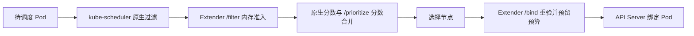

# 调度逻辑与本机集群验证

本文对应第一轮、第二轮优化后的代码，说明默认调度器集成方式下，一个 Pod 如何通过内存准入、负载打分和 Bind，以及 Operator 如何保护节点。部署与升级步骤见 [部署说明](DEPLOYMENT-STARTUP.md)，策略字段见 [SchedulerPolicy 配置](NODEBALANCER-CONFIG.md)。

本文中的参数值来自仓库默认值和策略样例。**集群实际镜像、实际策略和 scheduler 配置需要通过下面的命令确认**，不能仅凭文档判断某个版本已上线。

## 1. 调度请求经过哪些步骤

默认调度器的集成配置使用 `filterVerb: filter`、`prioritizeVerb: prioritize` 和 `bindVerb: bind`：



1. kube-scheduler 先检查资源 request、节点亲和性、taint/toleration、节点是否 cordon 等原生条件。
2. Extender 从这些候选节点中排除无法满足内存保护规则的节点，返回所有通过检查的节点。
3. kube-scheduler 合并原生打分与 Extender 的实测负载分数，再选择节点。
4. Extender 在 Bind 前重新读取 Pod 和节点，再检查内存门槛，登记过渡期预算，然后调用 Kubernetes Bind API。

当前分支将 Extender 接入默认调度器，业务 Pod 省略 `schedulerName` 即使用 `default-scheduler`，不需要优先级节点标签。Pod 显式指定其他 scheduler、填写 `nodeName`，或通过其他绑定路径运行时，需要按实际路径判断是否经过此 Extender。

仓库也提供可选的 `/filter_onlyone`：它先执行同样的内存过滤，再只返回 Extender 分数最高的一个节点，并列时轮询。**默认集成配置未启用这个接口**。使用 `/filter` 时，低负载是节点偏好，最终选择还受 kube-scheduler 其他分数影响。

## 2. 内存准入规则

### 2.1 计算公式

```text
当前占比 =（节点实测内存 + 尚未被采样覆盖的 Pod 预留）÷ Allocatable 内存

预计占比 =（节点实测内存 + 尚未被采样覆盖的 Pod 预留 + 新 Pod 内存预算）
           ÷ Allocatable 内存
```

Filter 和 Bind 都使用以下规则。重试同一个 Pod 时会先扣除自己的旧预留，再加入新 Pod 预算，避免重复计算。

| 节点状态 | 判断与动作 |
|---|---|
| 没有 `memory-blocked=true` 标签 | 预计占比 ≤80% 放行；>80% 拒绝并设置保护标签 |
| 已有 `memory-blocked=true` 标签 | 当前占比 ≤75%，且预计占比 ≤80%，才解除标签并放行；否则继续拒绝 |
| 缺失、无效或过期内存指标 | 排除该节点本轮准入 |
| 无法读取 Metrics API 或集群 Pod 列表 | 返回错误，停止本轮准入 |
| 新 Pod 没有正数内存预算 | 返回错误，需要设置正数 request 或 limit |

标签名称为 `scheduler.example.com/memory-blocked`。标签用于观测和恢复判断，实际拦截由 `/filter` 和 `/bind` 执行；它本身不会设置 Node 的 cordon 状态。80% 和 75% 目前是代码中的固定内存保护门槛，CR 中的 `highThreshold`、`recoveryThreshold` 控制另一套节点负载保护。

例如，Allocatable 为 `10Gi` 的节点：

```text
实测 6Gi + 预留 1Gi + 新 Pod 0.5Gi = 75%：未保护节点可放行
实测 6Gi + 预留 1Gi + 新 Pod 1.5Gi = 85%：拒绝
```

80% 是调度时的预测门槛。Pod 启动后可能增长到 request 以上，Metrics 也有采样延迟，因此实际占用仍可能超过 80%；后续新 Pod 会按更新后的实测值接受检查。

### 2.2 新 Pod 预算与超卖

**每个容器优先使用正数 memory request，没有正数 request 时回退到 memory limit**：

| 容器资源设置 | 用于预算的值 |
|---|---:|
| request `64Mi`，limit `128Mi` | `64Mi` |
| request `128Mi`，limit `128Mi` | `128Mi` |
| 没有正数 request，limit `128Mi` | `128Mi` |

Kubernetes 通常会把仅设置 limit 的容器 request 默认成同值；以 API Server 实际保存的 Pod 为准。`request < limit` 可以保留超卖空间，但 kube-scheduler 原生的 request 容量检查仍会执行。

整个 Pod 的预算还包括：

- 应用容器预算之和。
- 可重启 init 容器作为 sidecar 持续运行时的预算。
- 普通 init 容器执行阶段与当时已运行 sidecar 的峰值。
- 应用阶段和 init 阶段两者的较大值，加上 Pod memory Overhead。

稳定运行、且已经被采样覆盖的 Pod 使用节点实测内存。过渡期预算只补足 Bind、容器启动和指标采样之间的空隙。

### 2.3 绑定后预留何时释放

Bind 前以 Pod UID 登记预算，绑定成功、`spec.nodeName` 已填写后继续保留。释放条件是：

1. 所有应用容器及可重启 init 容器均处于 `Running`，并有有效 `StartedAt`。
2. NodeMetrics 的完整采样窗口起点不早于这些容器的启动时间。

```text
采样窗口起点 = timestamp - window
释放条件：每个持续运行容器的 StartedAt ≤ 采样窗口起点
```

因此，预留尚未释放时，拉取镜像、普通 init 执行、应用启动等待和重启等待期间不会仅因已经绑定或等待时间长而丢掉预算。已被采样覆盖并释放的预留，不会仅因后续容器重启在当前进程中重新登记；新 leader 初始化时会重新扫描。Pod 列表快照最多缓存 1 秒；Metrics API 结果最多缓存 5 秒。

Pod 被删除、进入 `Succeeded`/`Failed`、被同名新 UID 替换，或者 API 确认实际绑定到其他节点时，会清理对应旧预留。指标 `timestamp` 不得过旧（最多 2 分钟），最多允许 10 秒未来时钟偏差；`window` 必须为正数且不超过 2 分钟。未来偏差在允许范围内也不会提前释放预算。

Bind 超时、断连或冲突不能证明 API Server 没有完成绑定，预算会保留。同一 Pod UID 在结果确定前只允许重试原节点；若原节点一直不可用，需要删除并重建该 Pod。明确的新绑定拒绝，例如 Forbidden、Unauthorized、Invalid 或 NotFound，可撤销本次新预留。

新 leader 在开放 HTTP 前，从 API 重建已绑定但尚未被采样覆盖的 Pod 预算；稳定 Pod 不重复累计 request。重建覆盖全体已绑定 Pod，而不仅限于使用某个 schedulerName 的 Pod。

## 3. 负载分数怎么算

CPU 和内存使用率都以节点 Allocatable 为分母，分子来自 Metrics API 实测值。默认 CPU 权重 10%、内存权重 90%：

```text
CPU 使用率 = 实测 CPU ÷ Allocatable CPU × 100
内存使用率 = 实测内存 ÷ Allocatable 内存 × 100
加权负载 = CPU 使用率 × 0.10 + 内存使用率 × 0.90
Extender 分数 = round(10 × (1 - 加权负载 / 100))，限制在 0～10
```

例如 CPU 20%、内存 60% 时，加权负载为 56%，Extender 分数为 4。负载越低，分数越高。打分仅使用实测负载，过渡预留和新 Pod 预算用于前面的内存准入。

`SchedulerPolicy/cluster` 的 `cpuWeight`、`memoryWeight` 为整数百分比，每项 0～100，两者之和必须为 100。省略时默认 10/90，支持 `0/100`、`100/0` 和 `1/99`；运行时统一转换为比例供 Extender 和 NodeBalancer 使用。

评分时无法取得完整有效的候选节点负载，会给本次候选节点返回中性分 0。内存准入仍执行自己的指标校验；评分降级不代表可绕过内存门槛。单节点集群没有多个节点可供比较，只能观察准入和 Bind，无法验证负载分配倾向。

## 4. Operator 的节点负载保护

### 4.1 策略与每轮动作

策略通过集群级 CR `SchedulerPolicy/cluster` 配置。仓库样例为：

| 参数 | 样例值 | 含义 |
|---|---:|---|
| `checkIntervalSeconds` | 5 秒 | 周期协调间隔，Node/CR 变化也可触发协调 |
| `highThreshold` | 70% | 加权负载达到此值时进入新增 cordon 候选 |
| `recoveryThreshold` | 65% | 加权负载回落到此值或以下时恢复自动 cordon |
| `minSchedulableNodes` | 4 | 新增 cordon 应保留的受管可用节点数 |
| `topNodesCount` | 9 | 本轮高负载 cordon 候选数量上限 |

实际值以 `kubectl get schedulerpolicy cluster -o yaml` 为准。`minSchedulableNodes: 4` 在单节点集群上会阻止新增自动 cordon；80% 内存准入仍独立执行。若 `nodeSelector` 不匹配任何节点，NodeBalancer 不管理节点，Extender 仍检查 scheduler 提供的候选节点。

每轮流程：

1. 清理退出 `nodeSelector` 或加入 `ignoreNodes` 的节点上，本控制器留下的自动 cordon；清理不依赖 Metrics API。
2. 读取指标并计算实测加权负载，汇总缺失、无效和过期指标错误。
3. 恢复负载 ≤恢复阈值的自动 cordon 节点。
4. 在真正可用的受管节点中按负载降序取 Top N，对达到高阈值的节点考虑 cordon。
5. 每次新增 cordon 前重新读取节点集合和候选节点，确认资格及可用数量。已有故障使数量低于下限时，停止新增 cordon。

这些动作只改变节点是否接受后续新 Pod，**不会驱逐或迁移已有 Pod**。已有 Pod 的 toleration、亲和性等条件也不会由此修改。

### 4.2 什么是可用节点

用于 `minSchedulableNodes` 和 Top N 的节点需要同时满足：

- 在 `nodeSelector` 和 `ignoreNodes` 确定的管理范围内。
- `Ready=True`，没有删除时间，未 cordon。
- 没有 `scheduler.example.com/memory-blocked=true`。
- 没有 `NoSchedule` 或 `NoExecute` taint。
- CPU/内存指标有效且新鲜，Allocatable CPU 和内存均为正数。

这是普通业务的保守容量口径，带 toleration 的特殊 Pod 可能仍能使用 taint 节点。下限也不保证每个 Pod 都能调度，某个 Pod 还有自己的资源需求与亲和性。并发外部节点故障不能通过多节点 API 事务消除；新增 cordon 写入超时等结果不确定时，会停止本轮后续新增 cordon，下一轮重新读取。

`nodeSelector` 和 `ignoreNodes` 仅控制 NodeBalancer 的 cordon 管理范围，不是 Extender 准入白名单。

### 4.3 人工 cordon 和失败状态

控制器用 annotation `scheduler.example.com/auto-cordoned=true` 标记自动 cordon 所有权。未带该标记的人工 cordon 会保留。人工 uncordon 后遗留的自动标记会清理；节点退出管理范围时也只清理控制器的自动操作。

管理员要接管一个已自动 cordon 的节点，先去掉自动标记再执行人工 cordon，命令见 [管理员接管节点](NODEBALANCER-CONFIG.md#管理员接管节点)。仅在已自动 cordon 的节点上重复 `kubectl cordon`，API 无法表达所有权变更。

指标或 cordon/uncordon 操作失败会汇总到 CR `Ready=False`，返回错误触发重试；其他节点继续协调。下一轮完整成功时恢复 `Ready=True`。删除策略的节点清理失败时，finalizer 保留等待重试。

## 5. 就绪、启动和升级

| 信号 | 含义 |
|---|---|
| Manager `:8082/healthz` | 进程健康检查 |
| Manager `:8082/readyz` | 当前 leader 已加载策略、重建预留，并开始监听 Extender HTTP |
| Extender `:8080/health` | 已监听的 HTTP 服务返回 `{"status":"UP"}` |
| `SchedulerPolicy/cluster` 的 `Ready` | 最近一次策略协调是否完整成功 |

HTTP Ready 和 CR Ready 表达不同状态。例如部分受管节点缺指标时，HTTP 仍可接收请求，但 CR 可显示 `Ready=False`；该缺指标节点也会被内存准入排除。

Deployment 使用单副本 `Recreate`：先停止旧实例，再由新 leader 重建预算接管。升级过程中依赖 Extender 的新调度会短暂停顿，已有业务 Pod 继续运行。

默认 scheduler 已接入 Extender 时，Operator 自身需要启动旁路，避免新实例依赖尚未启动的自身 HTTP 服务。仓库 [config/bootstrap](../config/bootstrap/kustomization.yaml) 通过 `nodeName: m1` 固定 Operator 的运行节点，使 kubelet 直接接管。其他集群须修改实际节点名；新增 scheduler profile 不能绕过全局 `extenders`。部署命令是 `make deploy-bootstrap IMG=...`，具体操作见 [单实例接管和启动旁路](DEPLOYMENT-STARTUP.md#单实例接管和启动旁路)。

## 6. 在当前本机集群验证

以下命令按当前 Kubebuilder 部署名称编写。若本机修改了 namespace 或 Deployment 名称，按实际配置替换。

### 6.1 确认镜像、策略和指标

```bash
kubectl -n i-scheduler-extender-system get deployment i-scheduler-extender-controller-manager \
  -o jsonpath='{.spec.template.spec.containers[?(@.name=="manager")].image}{"\n"}'
kubectl -n i-scheduler-extender-system get pods -o wide
kubectl -n i-scheduler-extender-system get endpoints i-scheduler-extender-http
kubectl get schedulerpolicy cluster -o yaml
kubectl top nodes
kubectl get nodes -L scheduler.example.com/memory-blocked
```

检查 Pod `Ready`、Service Endpoint、CR `status.conditions`、`status.observedGeneration` 和实际策略范围。在控制平面节点读取现有 kube-scheduler 的配置，确认 `default-scheduler` 和三个 Extender verb 符合第 1 节；Kubernetes 1.22 的配置示例见 [v1beta2 配置](kube-scheduler-config-v1beta2.yaml)。

`kubectl top nodes` 显示的是工具自身计算的百分比，直接对照门槛时应使用 Metrics API memory 数量和 Node Allocatable，避免混用不同分母。

### 6.2 一个小 Pod 检查真实调度链路

当前单节点 `m1` 已缓存 `mirror.gcr.io/library/alpine:3`，而 Docker Hub 拉取 BusyBox 超时。可直接使用仓库中的 [本机缓存镜像验证清单](scheduler-extender-check-local.yaml)：

```bash
kubectl apply -f deploy/scheduler-extender-check-local.yaml
kubectl get pod scheduler-extender-check -o wide
```

该清单使用 `imagePullPolicy: Never`，只适用于已缓存此镜像的节点；在其他集群先准备镜像，或使用下面的通用清单。它省略 `schedulerName` 和 `nodeName`，保留真实调度路径。检查及清理步骤见下方。

保存为 `scheduler-extender-check.yaml` 并应用：

```yaml
apiVersion: v1
kind: Pod
metadata:
  name: scheduler-extender-check
  namespace: default
spec:
  restartPolicy: Never
  containers:
    - name: check
      image: busybox:1.36
      command: ["sleep", "600"]
      resources:
        requests:
          cpu: 10m
          memory: 64Mi
        limits:
          cpu: 100m
          memory: 128Mi
```

```bash
kubectl apply -f scheduler-extender-check.yaml
kubectl get pod scheduler-extender-check -o wide
kubectl get pod scheduler-extender-check -o jsonpath='{.spec.schedulerName}{"\n"}'
kubectl describe pod scheduler-extender-check
kubectl -n i-scheduler-extender-system logs deployment/i-scheduler-extender-controller-manager \
  -c manager --since=10m --tail=200
```

预期 `schedulerName` 为 `default-scheduler`，Pod 出现 `spec.nodeName`，事件记录成功调度，Manager 日志出现 `bound pod: default/scheduler-extender-check to node:...`。单独看到 schedulerName 或成功事件，不能证明 Extender 已接入；结合 Bind 日志和 scheduler 的 Extender 配置确认链路。

若 Pod Pending，先看事件：原生 request 容量、taint 或 affinity 失败需要检查原生条件；缺预算、指标异常或内存门槛拒绝需要检查 Manager 日志和节点保护标签。若出现 `node.kubernetes.io/disk-pressure:NoSchedule` 或 `DiskPressure=True`，原生调度器会先挡住普通 Pod，应处理节点磁盘压力并等待节点状态恢复，再试调度。这个结果不能用于判断 Extender 的内存规则是否有效，也无需为测试添加容忍来绕过节点压力保护。

Pod 已绑定但 `ImagePullBackOff` 属于拉取镜像问题，此时过渡预算仍保留。Filter/Prioritize 细节日志采用 klog `V(2)`/`V(4)`，默认日志不一定包含每次 Filter 或分数；可用下一节直接查看 HTTP 返回值。

完成后删除这个测试 Pod：

```bash
kubectl delete pod scheduler-extender-check
```

### 6.3 直接查看 Filter 和 Prioritize 返回值

在一个终端转发 Manager 端口，保持命令运行：

```bash
kubectl -n i-scheduler-extender-system port-forward \
  deployment/i-scheduler-extender-controller-manager 18080:8080 18082:8082
```

在另一个终端执行。需要本机已有 `curl`、`python3`；下面只构造 HTTP 请求，不创建额外 Pod，也不调用 Bind。

```bash
curl -fsS http://127.0.0.1:18082/readyz
curl -fsS http://127.0.0.1:18080/health
kubectl get nodes -o json > /tmp/scheduler-extender-check-nodes.json
python3 - <<'PY'
import json

with open('/tmp/scheduler-extender-check-nodes.json') as source:
    nodes = json.load(source)
pod = {
    'apiVersion': 'v1', 'kind': 'Pod',
    'metadata': {'name': 'filter-probe', 'namespace': 'default'},
    'spec': {'containers': [{
        'name': 'check', 'image': 'busybox:1.36',
        'resources': {'requests': {'memory': '64Mi'}, 'limits': {'memory': '128Mi'}}
    }]}
}
with open('/tmp/scheduler-extender-check-small.json', 'w') as output:
    json.dump({'Pod': pod, 'Nodes': nodes}, output)
PY
curl -fsS -H 'Content-Type: application/json' \
  --data-binary @/tmp/scheduler-extender-check-small.json \
  http://127.0.0.1:18080/filter > /tmp/scheduler-extender-check-filtered.json
python3 -m json.tool /tmp/scheduler-extender-check-filtered.json
```

Filter 返回 `Nodes.items` 是通过检查的节点；空列表表示没有内存安全候选，`Error` 非空表示输入或依赖错误。协议错误可能写在 HTTP 200 的 JSON 响应里，需要查看响应体。该请求包含全部节点，**没有执行 kube-scheduler 原生过滤**，因此返回结果不能证明这些节点满足某个业务 Pod 的 taint 或 affinity 条件。

`/filter` 使用真实准入逻辑，普通请求也可能设置或恢复节点的内存保护标签。它不会绑定虚拟 Pod、创建预算或分配实际内存。只用 Filter 返回的安全节点请求打分，先生成请求文件：

```bash
python3 - <<'PY'
import json

with open('/tmp/scheduler-extender-check-small.json') as source:
    request = json.load(source)
with open('/tmp/scheduler-extender-check-filtered.json') as source:
    result = json.load(source)
if result.get('Error') or not (result.get('Nodes') or {}).get('items'):
    raise SystemExit('没有安全节点；先检查 Filter 返回值和指标，不继续打分。')
request['Nodes'] = result['Nodes']
with open('/tmp/scheduler-extender-check-prioritize.json', 'w') as output:
    json.dump(request, output)
PY
```

上一步成功生成本次请求文件后，再执行下面的命令；若 Python 提示没有安全节点，则先处理 Filter 错误，避免读取上一次留下的打分请求。

```bash
curl -fsS -H 'Content-Type: application/json' \
  --data-binary @/tmp/scheduler-extender-check-prioritize.json \
  http://127.0.0.1:18080/prioritize
```

返回数组中的 `Host` 与 `Score` 可与第 3 节公式对照。多节点时可以比较负载高低对应的分数；这仍只是 Extender 分数，真实 scheduler 会合并其他分数。

### 6.4 不分配大内存的门槛检查

要检查超出门槛的预算被拒绝，可以使用**请求内的模拟保护标记**，无需创建大 Pod、压满节点或修改真实节点标签。下面选择一个实际节点，将请求中该节点的 `memory-blocked` 标记设为 `true`，把虚拟 Pod 的 request 设置为这个节点的整个 Allocatable 内存。

这一预算单独就超过 80%，走的是“保持保护并拒绝”分支，代码不会写入节点标签。模拟标签只存在于 JSON 文件中，没有使用 `kubectl label`。此检查覆盖已保护节点的门槛判断；自动打标签、真实 Bind 和预留采样释放需结合真实工作负载观察。

先刷新节点快照，然后生成请求。`m1` 替换为要查看的实际节点：

```bash
kubectl get nodes -o json > /tmp/scheduler-extender-check-nodes.json
python3 - m1 <<'PY'
import copy
import json
import sys

with open('/tmp/scheduler-extender-check-nodes.json') as source:
    nodes = json.load(source)
node = copy.deepcopy(next(item for item in nodes['items']
                         if item['metadata']['name'] == sys.argv[1]))
node['metadata'].setdefault('labels', {})['scheduler.example.com/memory-blocked'] = 'true'
pod = {
    'apiVersion': 'v1', 'kind': 'Pod',
    'metadata': {'name': 'threshold-probe', 'namespace': 'default'},
    'spec': {'containers': [{
        'name': 'check', 'image': 'busybox:1.36',
        'resources': {'requests': {'memory': node['status']['allocatable']['memory']}}
    }]}
}
nodes['items'] = [node]
with open('/tmp/scheduler-extender-check-threshold.json', 'w') as output:
    json.dump({'Pod': pod, 'Nodes': nodes}, output)
PY
curl -fsS -H 'Content-Type: application/json' \
  --data-binary @/tmp/scheduler-extender-check-threshold.json \
  http://127.0.0.1:18080/filter
kubectl get nodes -L scheduler.example.com/memory-blocked
```

在该节点指标正常且新鲜的前提下，预期 `Nodes.items` 和 `NodeNames` 都为空，`Error` 为空，真实节点标签不因这次模拟请求改变。缺指标时同样会被排除，因此要先完成小请求与指标检查，再解释这个结果。

低风险检查完成后，在有余量的本机集群自行观察实际业务：连续小 Pod 的 Bind、启动与采样过渡，或者在多节点集群比较分布。观察保护规则时，以实际 CR、实测内存、Allocatable、Pod 预算和对应时间段日志为准。
