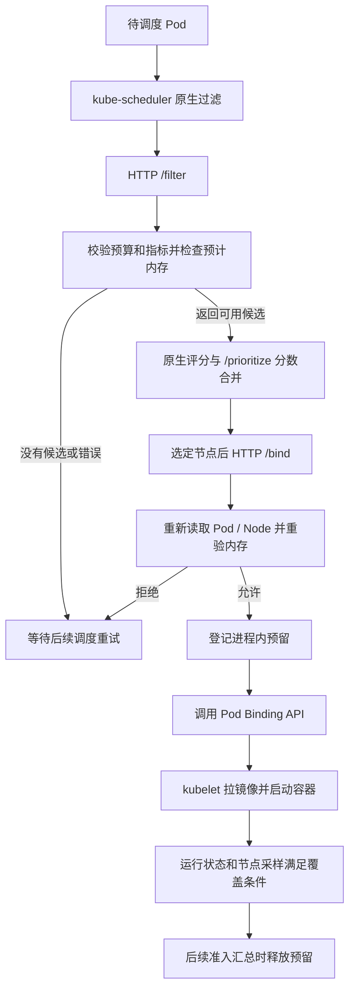

# Pod 调度链路

## 1. 一次请求怎么走



图中主路径表示一次成功调度。Filter 的许可不会锁定容量，所以 Bind 需要再验；预留在 API Bind 前登记，让后续请求立即看到预算。容器启动属于 kubelet 的职责，Extender 通过 Pod 状态和指标间接观察它。

接入配置使用 `/filter`，没有启用可选的 `/filter_onlyone`。[配置](../../../deploy/kube-scheduler-config-v1beta2.yaml)、[可选单节点过滤](../../../pkg/extender/filter.go#L121)。业务 Pod 省略 `schedulerName` 只有在默认 scheduler 已接入 Extender 的集群上才会经过这条路径；填写 `nodeName` 会绕过节点选择。

## 2. Filter：判断能否接纳

输入是 `ExtenderArgs`，包含 Pod 和候选 Node；输出是候选子集或协议错误。[HTTP 入口](../../../pkg/server/handler.go#L48)、[算法入口](../../../pkg/extender/filter.go#L21)。

```text
预计占比 =（节点实测内存 + 尚未被采样覆盖的预留 + 本次 Pod 预算）/ Allocatable
```

`Allocatable` 是节点报告的可分配资源。这里采用节点级实测内存，所以公式不是“所有运行 Pod 的 request 求和”。同一 Pod 重试时扣除自己的旧预留，避免重复计算。[filter.go:79](../../../pkg/extender/filter.go#L79)。

| 情况 | 处理 |
|---|---|
| 未保护，预计占比 ≤80% | 放行 |
| 未保护，预计占比 >80% | 排除，尝试设置内存保护标签 |
| 已保护，当前含预留占比 >75%，或预计占比 >80% | 保持排除 |
| 已保护，当前含预留占比 ≤75%，且预计占比 ≤80% | 清除标签成功后放行 |
| Pod 预算为零或读取指标/Pod 快照失败 | 返回错误 |
| 某候选节点指标缺失、过期或无效 | 排除该节点 |

80 与 75 之间的间隔叫**滞回**：进入与退出条件不同，减少状态在门槛附近来回切换。[决策函数](../../../pkg/extender/memory_guard.go#L37)。恢复在 Filter/Bind 请求中判断，没有独立周期负责清除所有内存保护标签。

## 3. request、limit 和预算

每个容器优先取正数 memory request，没有时回退到 limit。应用容器相加；普通 init 容器依次运行，按阶段峰值计算；可重启 init sidecar 会叠加到后续阶段；最后加入 Pod Overhead，即容器之外的 Pod 资源开销。[usage.go:118](../../../pkg/nodeusage/usage.go#L118)。

例如 request=64Mi、limit=128Mi 的 `sleep` Pod，本项目取 64Mi 预算。该声明不会让 `sleep` 实际占用 64Mi；request 也不是运行上限。API 默认化或准入可能补充 request，因此应以 API 中实际 Pod 的值为准。

允许 request 小于 limit 保留了超卖空间，但运行中的 Pod 可以增长超过 request，采样也有延迟；80% 是调度预测门槛，不能保证物理用量永不超过 80%。

## 4. Prioritize：在候选中表达偏好

默认综合使用率是 `CPU% × 0.1 + 内存% × 0.9`，权重来自 CR。[计算函数](../../../pkg/nodeusage/usage.go#L68)。

分数为 `round(10 × (1 − 综合使用率/100))`，范围 0～10。综合使用率 20% 得 8 分，70% 得 3 分。[score.go:9](../../../pkg/extender/score.go#L9)。这里只看实测值，不加预留或本次 Pod 预算。

任一候选指标缺失或用量计算失败时，全体候选返回相同的 0 分，保留原生评分的相对关系。[prioritize.go:18](../../../pkg/extender/prioritize.go#L18)。

**需要注意的源码事实**：该路径调用 `WeightedUsagePercentage`，没有单独调用 `MemorySampleStart` 检查时间戳。Filter 会检查内存样本时效，但两个阶段可能读取不同批次缓存；评分自身的时效保证值得补齐。当前分数还会取整，使用率接近的节点可能同分。

## 5. Bind：重新检查并登记预算

输入是 Pod 名称、命名空间、UID 和选定节点；输出 `ExtenderBindingResult` 中的错误字符串。[bind.go:23](../../../pkg/extender/bind.go#L23)。

1. 获取当前 Pod，检查 UID，防止同名重建导致绑定错对象。
2. 若已经绑定到目标节点，按成功重试处理；已绑定其他节点则拒绝。
3. 若存在未解决的旧绑定预留，只允许重试原节点。
4. 读取指标、当前 Node 和 Pod 快照，重新计算内存准入。
5. 先登记预留，再调用 API Bind。
6. 成功后等待状态/采样接替；超时或冲突等不确定结果继续保留预算。

对新的预留，只有特定确定拒绝错误才释放；已有旧预留时也不因新的失败贸然删除。[bind.go:117](../../../pkg/extender/bind.go#L117)。因此网络超时意味着“客户端不知道结果”，不能直接当作“服务器没绑定”。

`admissionMu` 将 Filter、Bind 和启动重建串行化，保证重验与预算登记之间不会被另一轮准入插入。[锁定义](../../../pkg/extender/extender.go#L36)。锁会覆盖 API 读取和写入，简单可靠的代价是一个慢请求可能拖住其他节点的准入。

## 6. 预留何时释放

预留按命名空间、名称和 UID 识别，没有固定到期时间。[预留结构](../../../pkg/extender/memory_guard.go#L56)。

- 最新快照证明 Pod 已删除、换 UID、终止或实际绑定到其他节点，清理旧预留。
- Pod 绑定到预留节点，所有应用容器和可重启 init sidecar 都处于 Running，且 StartedAt 不晚于节点采样窗口起点，判定被实测覆盖，释放预留。
- 拉镜像失败、普通 init 执行或尚未被采样覆盖，继续保留。

覆盖条件是本项目采用的保守判断规则，不是逐个容器的实测计量证明。[覆盖函数](../../../pkg/extender/memory_guard.go#L77)、[汇总与清理](../../../pkg/extender/memory_guard.go#L107)。清理发生在后续 Filter/Bind 汇总时，而非单独后台任务。

启动时重建已绑定且未覆盖的 Pod 预算。[InitializeMemoryReservations](../../../pkg/extender/memory_guard.go#L209)。未绑定的模糊结果只存在进程内表中，启动重建不会恢复这类记录；已释放预留的运行 Pod 后续重启也没有常驻逻辑重新登记。这些边界需要专项故障分析，不能仅凭当前预留规则宣称完全覆盖所有生命周期。

## 7. 缓存与验证边界

节点指标成功缓存 5 秒、错误缓存 2 秒；Pod 快照缓存 1 秒。缓存降低 API 压力，但增加延迟。[指标缓存](../../../pkg/extender/extender.go#L103)、[Pod 缓存](../../../pkg/extender/memory_guard.go#L134)。指标样本本身不得超过 2 分钟。[时效校验](../../../pkg/nodeusage/usage.go#L27)。

已有[预留测试](../../../pkg/extender/memory_reservations_test.go)涉及长 Pending、旧快照、UID、模糊绑定、启动恢复等场景。本轮只阅读用例，未执行；用例也不能替代并发吞吐、控制平面重启或真实内存压力验证。
