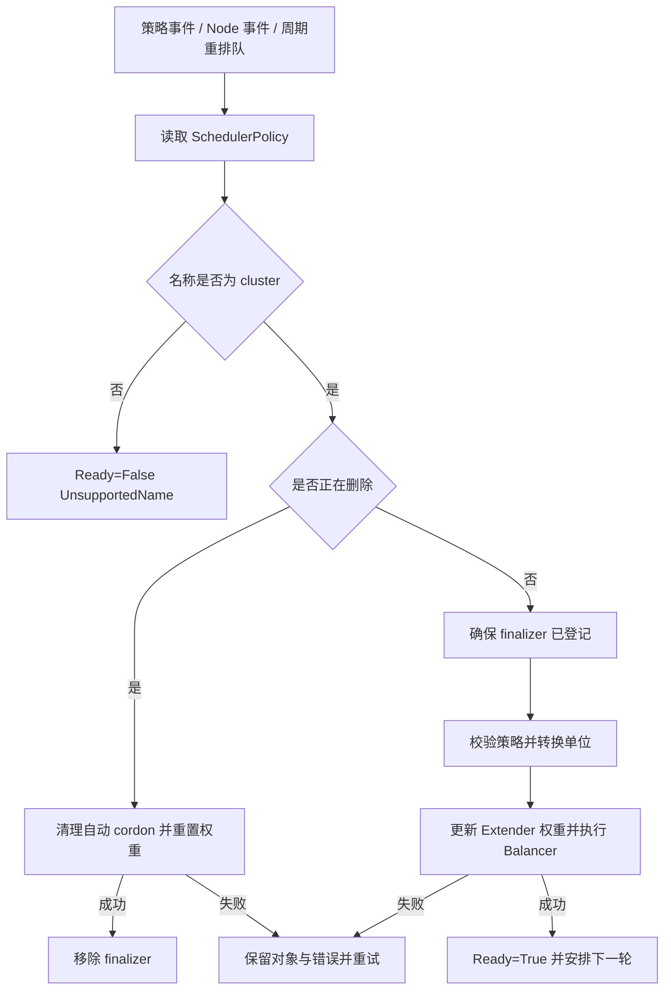

# 策略控制与设计取舍

## 1. CRD 和控制器如何配合

CRD 定义类型与字段规则，`SchedulerPolicy/cluster` 保存期望策略，控制器的 `Reconcile` 负责把策略落实到共享评分权重和 Node 状态。它不要求每个业务 Pod 创建对应 CR。[类型](../../../api/v1alpha1/schedulerpolicy_types.go#L19)、[协调入口](../../../internal/controller/scheduler_policy_controller.go#L55)。

事件和周期共同触发协调。删除路径必须先完成清理，才移除 finalizer；finalizer 是 Kubernetes 对象上的删除前清理标记，避免策略消失后遗留自动封禁。[删除与正常协调](../../../internal/controller/scheduler_policy_controller.go#L81)。

权重使用 `*int32`，区分“没有填写”和“明确填 0”。API 百分比 10/90 在边界转换为运行时比例 0.1/0.9，总和规则由程序校验。[ResolveWeights](../../../api/v1alpha1/schedulerpolicy_types.go#L106)。

状态记录 `ObservedGeneration` 和 Ready condition，表示处理过哪个 spec 版本以及是否成功。补丁使用 resourceVersion 检测并发变化，失败可重试。[状态更新](../../../internal/controller/scheduler_policy_controller.go#L158)。

## 2. Balancer 实际做什么

一次 `Balancer.Reconcile` 的主要顺序：[node_balancer.go:96](../../../pkg/rebalancer/node_balancer.go#L96)。

1. 读取节点，清理退出管理范围的自动封禁和人工恢复后的旧标记。该清理先于 Metrics API 读取。
2. 读取指标，校验时效和单位，计算受管节点的加权负载。
3. 恢复本控制器封禁且负载降到恢复门槛的节点。
4. 重新读取节点，在真正可用节点中选高负载 Top N 候选。
5. 每次封禁前重新检查可用数量和候选资格；达到最少可用数量就停止新增封禁。
6. 汇总错误。确定拒绝可以继续处理其他候选；模糊写入失败停止本轮新增封禁，避免重复减少容量。

默认策略高负载门槛为 70、恢复为 65、最少可用数量 4、Top N 为 9。这是加权 CPU/内存负载，与 Extender 的纯内存 80/75 规则不同。

**cordon** 是把 Node 的 `spec.unschedulable` 设为 true，阻止普通后续调度；**uncordon** 恢复这一状态。此模块没有 eviction 或迁移已有 Pod 的流程，因此名字 `rebalancer` 对应的是未来调度入口的负载保护。[节点写入](../../../pkg/rebalancer/node_balancer.go#L411)。

可用节点须匹配管理范围、Ready、未删除、未 cordon、没有内存保护标签、无 NoSchedule/NoExecute 污点且指标有效。[available](../../../pkg/rebalancer/node_balancer.go#L271)。这是普通业务的保守计数，不能保证这些节点都满足某个具体 Pod 的亲和性或资源需求。

## 3. 节点所有权与错误处理

自动 cordon 使用 `scheduler.example.com/auto-cordoned` 注解表示所有权。没有注解的人工封禁不会被恢复；更新时重新检查 UID 和标记，避免同名节点替换或并发人工操作被旧快照覆盖。[updateUnschedulable](../../../pkg/rebalancer/node_balancer.go#L411)。

管理员接管自动封禁节点时，需先移除自动标记，具体命令见[策略配置](../../../deploy/节点保护策略配置.md#管理员接管节点)。`nodeSelector` 和 `ignoreNodes` 只限定这一套节点封禁管理，不会让节点跳过 Extender 内存准入。

部分节点成功、其他节点失败时，控制器设置 Ready=False 并重试；成功动作不回滚。权重更新先于 Balancer 执行，所以 Ready=False 也可能已经应用了新权重。[应用顺序](../../../internal/controller/scheduler_policy_controller.go#L107)。

## 4. 当前设计取舍

以下是基于源码的设计分析，不是对历史决策原因的断言。

| 做法 | 能解决什么 | 代价与边界 |
|---|---|---|
| Extender 与原生 scheduler 协作 | 保留原生约束，加入实测判断 | HTTP、Service、DNS 和 Metrics API 成为调度依赖 |
| request 优先预算 | 允许 request 与 limit 不同，保留超卖空间 | 运行增长和采样延迟仍可能突破预测门槛 |
| Bind 重验与无 TTL 预留 | 补足并发绑定、拉镜像和采样之间的空隙 | 长期启动失败持续占预算，需观测和清理原因 |
| 进程内预留与选主、单副本 Recreate | 避免常规多实例独立账本 | 升级存在服务空窗；未绑定的模糊结果不能由 API 快照完整重建 |
| 全局准入锁 | 容易保证重验和登记顺序 | API 慢请求会阻塞其他节点，需要负载数据后再决定是否细化 |
| 自动 cordon 而不迁移 | 实现范围清楚，不主动打断已有工作负载 | 高负载来源继续运行，不会主动均衡已有 Pod |

默认 scheduler 接入后，Operator 自身重启可能依赖尚未启动的自身接口。`config/bootstrap` 用 `nodeName: m1` 提供启动旁路，部署到其他集群需修改节点名。[bootstrap 补丁](../../../config/bootstrap/manager_bootstrap_patch.yaml)。这一固定节点策略是部署取舍，不是通用高可用方案。

## 5. 后续优化候选

本轮只列问题和推进方式，没有修改调度源码。

| 顺序 | 候选问题 | 源码依据 | 下一步需要什么 |
|---|---|---|---|
| 1 | 评分路径独立补齐指标时效校验 | [prioritize.go:43](../../../pkg/extender/prioritize.go#L43) | 明确过期样本降级行为，与 Filter 规则统一 |
| 2 | 让拒绝原因和预留账本更容易观察 | Filter 没有填逐节点失败原因；预留当前在内部 map | 设计节点原因、预留大小/数量/年龄及 API 延迟观测 |
| 3 | 评估模糊 Bind 后进程重启的恢复边界 | [初始化只处理已绑定 Pod](../../../pkg/extender/memory_guard.go#L221) | 构造故障时序；比较恢复等待与持久化账本的复杂度 |
| 4 | 评估采样覆盖判断与容器重启预算 | [podMemoryCovered](../../../pkg/extender/memory_guard.go#L77) | 区分已释放与尚未释放预留，分析需要新增什么状态 |
| 5 | 评估准入锁和全量 API 读取的扩展成本 | [admissionMu](../../../pkg/extender/extender.go#L36)、[全量 Pod 列表](../../../pkg/extender/memory_guard.go#L144) | 先收集真实节点/Pod 数、请求并发和延迟，再考虑按节点锁或 informer |
| 6 | 评估升级空窗和默认 scheduler 故障行为 | [Recreate](../../../config/manager/manager.yaml)、[Extender 配置](../../../deploy/kube-scheduler-config-v1beta2.yaml) | 验证服务断连、DNS 故障和重启；决定更偏安全还是可用 |

已有控制器和 Balancer 测试描述了部分失败重试、人工所有权、可用数量和模糊写入场景：[控制器测试](../../../internal/controller/scheduler_policy_controller_test.go)、[Balancer 测试](../../../pkg/rebalancer/node_balancer_round2_test.go)。它们是学习输入，本轮没有运行，也不能据此确定线上所有故障场景都已覆盖。

建议下一轮先深入“Bind 超时后到底发生了什么”：从客户端请求、服务器绑定结果、预留表和重启重建四个角度画时序，再决定是否需要代码改动。
