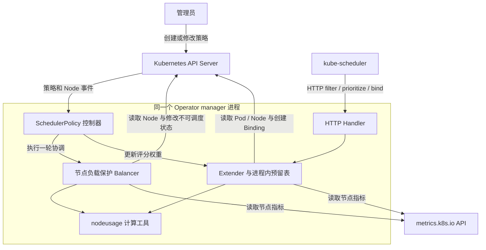
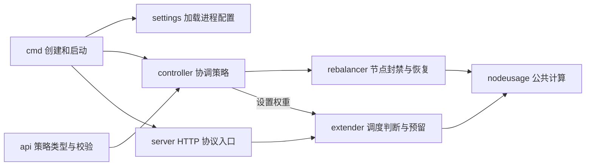

# 整体架构

## 1. 解决的问题与边界

原生调度器负责选择满足 request、亲和性、污点等条件的节点。本项目接收它提供的候选节点，再加入节点实测用量判断。另一条周期协调路径可把高负载节点标记为不可调度。

**Operator** 可以理解为“用 Kubernetes 资源表达期望配置，并持续协调实际状态的程序”。本项目的自定义资源类型定义是 **CRD**；用户创建的 `SchedulerPolicy/cluster` 是该类型的一个 **CR 对象**。[定义入口](../../api/v1alpha1/schedulerpolicy_types.go#L19)。

**Extender** 是 kube-scheduler 调用的 HTTP 扩展接口。它参与过滤、评分和绑定；已有 kube-scheduler 继续承担整体调度流程。[接入配置](../../deploy/kube-scheduler-config-v1beta2.yaml)。

## 2. 组件架构图

箭头表示请求、事件或函数调用方向。调度请求走 `Handler → Extender`，策略事件走 `控制器 → Balancer`；两条路径通过共享评分权重、Node 标签和不可调度状态协作。Metrics API 提供节点用量，API Server 保存 Pod、Node 和策略对象。

源码依据：[注册和共享 Extender](../../cmd/main.go#L73)、[HTTP 注册](../../pkg/server/handler.go#L23)、[策略协调](../../internal/controller/scheduler_policy_controller.go#L107)、[Node 事件监听](../../internal/controller/scheduler_policy_controller.go#L220)。

## 3. 模块功能图

此图强调代码分工。`server` 处理协议，算法在 `extender`；`controller` 处理协调框架和 CR 状态，节点决策在 `rebalancer`。`nodeusage` 统一单位和计算规则，避免两条路径各自解释资源值。

## 4. 启动顺序

1. `main → run` 加载 YAML，创建核心 API 客户端和动态客户端。[main.go:54](../../cmd/main.go#L54)。
2. 创建一个共享 Extender 和 controller-runtime manager；注册策略控制器。[main.go:74](../../cmd/main.go#L74)。
3. HTTP 服务通过 `NeedLeaderElection` 声明需要 leader 身份；启用选主时，获得租约后才启动。[extender_server.go:45](../../cmd/extender_server.go#L45)。
4. 直接从 API 读取初始权重，然后重建已绑定但尚未被指标覆盖的 Pod 预算。[main.go:108](../../cmd/main.go#L108)。
5. 关闭 `startupReady` 通道，解除控制器的启动等待；监听 HTTP，进入接收连接阶段后通过 readiness。[extender_server.go:65](../../cmd/extender_server.go#L65)。
6. 退出时撤销内部就绪状态，等待请求结束，超时则关闭连接。Kubernetes 根据探针异步更新 Service Endpoint，并非瞬间完成。[extender_server.go:108](../../cmd/extender_server.go#L108)。

**manager** 是 controller-runtime 提供的运行管理器，组织控制器、缓存、选主、探针和服务生命周期。**readiness** 表示实例是否适合接收流量；**liveness** 表示进程是否存活。`/health` 的 UP 响应不证明每个节点的指标都可用。[探针配置](../../config/manager/manager.yaml)。

## 5. 配置分三层

| 层次 | 入口 | 管什么 | 更新方式 |
|---|---|---|---|
| 进程启动 | [scheduler.yaml](../../config/manager/scheduler.yaml) | 监听地址、选主 | 修改配置后重启进程 |
| 集群策略 | [SchedulerPolicy 样例](../../config/samples/scheduler_v1alpha1_schedulerpolicy.yaml) | 权重、节点负载阈值、范围、周期、最少可用数量 | CR 事件触发协调 |
| 控制平面 | [scheduler 配置示例](../../deploy/kube-scheduler-config-v1beta2.yaml) | 默认 profile、Extender 地址和接口 | 管理员修改并让 scheduler 重新加载 |

80%/75% 的 Extender 内存门槛是[代码常量](../../pkg/extender/memory_guard.go#L16)，不由 CR 的 `highThreshold` 和 `recoveryThreshold` 控制。Operator 不会自动修改服务器 `/etc/kubernetes` 下的 scheduler 配置。

## 6. 技术栈的实际作用

| 技术 | 本项目用途 | 证据 |
|---|---|---|
| Kubebuilder | 项目骨架、API 标记、CRD/RBAC 等生成与部署布局 | [PROJECT](../../PROJECT)、[类型标记](../../api/v1alpha1/schedulerpolicy_types.go#L24) |
| controller-runtime 0.19.1 | manager、事件协调、CR 状态补丁、选主 | [go.mod](../../go.mod)、[控制器](../../internal/controller/scheduler_policy_controller.go#L220) |
| client-go 0.31.2 | typed client 访问 Pod/Node，dynamic client 访问 Metrics API | [客户端创建](../../cmd/main.go#L64) |
| Go net/http | 提供 Extender HTTP 服务与关闭流程 | [HTTP 服务](../../cmd/extender_server.go#L88) |
| Kustomize | 组合标准部署资源和启动旁路补丁 | [bootstrap](../../config/bootstrap/kustomization.yaml) |

源码依赖版本不等于线上集群版本，也不能单凭这张表断言支持所有 Kubernetes 版本。现有部署示例面向 Kubernetes 1.22，需要单独评估其他版本的 scheduler 配置 API。
